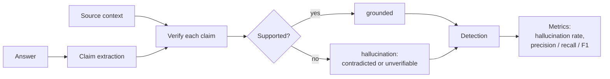
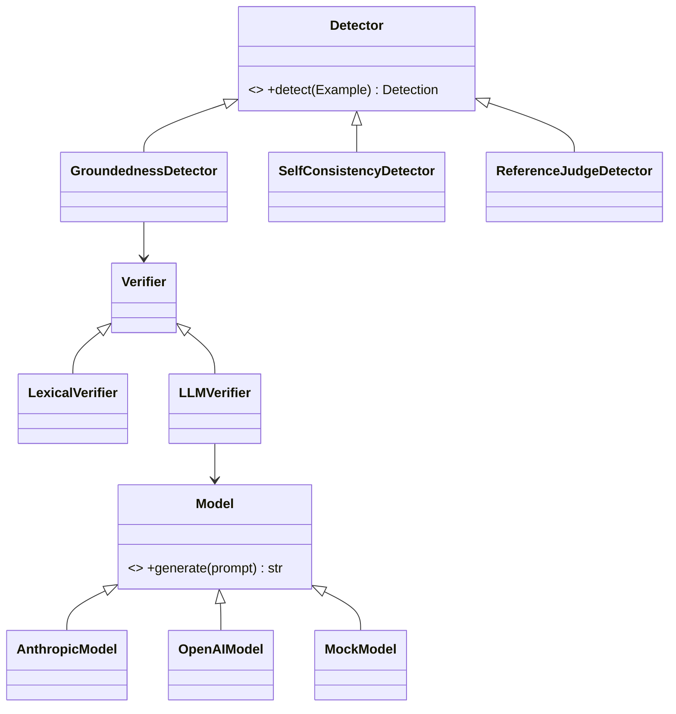

# hallucination-hunter

**A small, runnable harness for detecting and evaluating hallucinations in LLM output.**

LLMs state things that aren't true with total confidence. `hallucination-hunter`
checks whether the claims in an answer are actually *grounded* — supported by a
source you trust — and measures how well a detector catches the ones that aren't.

It is a real tool, not a slide deck:

- A `hh` command-line tool and a clean Python API.
- A pluggable detector architecture (groundedness ships in v0.1; self-consistency
  and reference-judge are wired in behind the same interface).
- Pluggable model backends — **Anthropic**, **OpenAI**, and a deterministic
  **mock** so the whole thing runs, and the full test suite passes, **with zero
  API keys**.
- Labeled datasets and detection-quality metrics (precision / recall / F1), not
  just a vibe check.

> The core engine, the lexical detector, the mock backend, the metrics, and the
> CLI depend on **nothing but the Python standard library**. Clone it and it runs.

---

## Quickstart

```bash
git clone https://github.com/ramenprotokol/hallucination-hunter.git
cd hallucination-hunter
pip install -e ".[dev]"        # core + pytest; no API keys needed

# check a single answer against a source context
hh detect \
  --answer "The Eiffel Tower is in Paris. It was designed by Leonardo da Vinci." \
  --context "The Eiffel Tower is a wrought-iron tower in Paris, completed in 1889 by Gustave Eiffel's company."

# evaluate a detector over a labeled dataset and print detection quality
hh eval --dataset data/groundedness_eval.jsonl --detector groundedness --format markdown
```

`hh detect` above flags the da Vinci claim as unsupported while passing the
"in Paris" claim — no API key required, because the default verifier is the
deterministic lexical baseline.

To run with a real model judge:

```bash
pip install -e ".[anthropic]"
export ANTHROPIC_API_KEY=...
hh eval --dataset data/groundedness_eval.jsonl --verifier llm --model anthropic
```

## How it works

An answer is **grounded** if every factual claim it makes is supported by the
provided context. The pipeline checks that one claim at a time:



Each claim gets one of three verdicts:

| Verdict | Meaning | Counts as hallucination? |
|---|---|---|
| `supported` | the context entails the claim | no |
| `contradicted` | the context states the opposite | **yes** |
| `unverifiable` | no evidence in the context either way | **yes** |

## Architecture

Two seams keep the tool extensible: **detectors** (how you decide if something is
a hallucination) and **model backends** (which LLM, if any, does the judging).



- **Detectors** (`hh.detectors`) — `groundedness` (claims vs context),
  `self_consistency` (sample N times, flag disagreement, no context needed),
  `reference_judge` (judge against a gold answer).
- **Verifiers** — inside groundedness: `lexical` (token-overlap baseline, no
  model) or `llm` (a judge model with a strict rubric).
- **Backends** (`hh.models`) — `anthropic`, `openai`, `mock`. Optional providers
  are imported lazily, so missing them never breaks the core.

See [`docs/architecture.md`](docs/architecture.md), the
[methodology](docs/methodology.md), and the [taxonomy of hallucinations](docs/taxonomy.md).

## Python API

```python
import hh

context = "Marie Curie won Nobel Prizes in Physics (1903) and Chemistry (1911)."
result = hh.detect("Marie Curie won three Nobel Prizes.", context)

print(result.predicted_hallucinated)   # True
for v in result.verdicts:
    print(v.support.value, "-", v.claim.text)
```

## Datasets

JSONL, one example per line. The `data/` directory ships labeled sets you can run
immediately; the schema is documented in [`data/README.md`](data/README.md).

```json
{"id": "q001", "prompt": "...", "context": "...", "answer": "...",
 "labels": {"hallucinated": true, "unsupported_claims": ["..."]}}
```

## Development

```bash
pip install -e ".[dev]"
pytest            # full suite runs offline, no API keys
```

## License

MIT — see [LICENSE](LICENSE).
