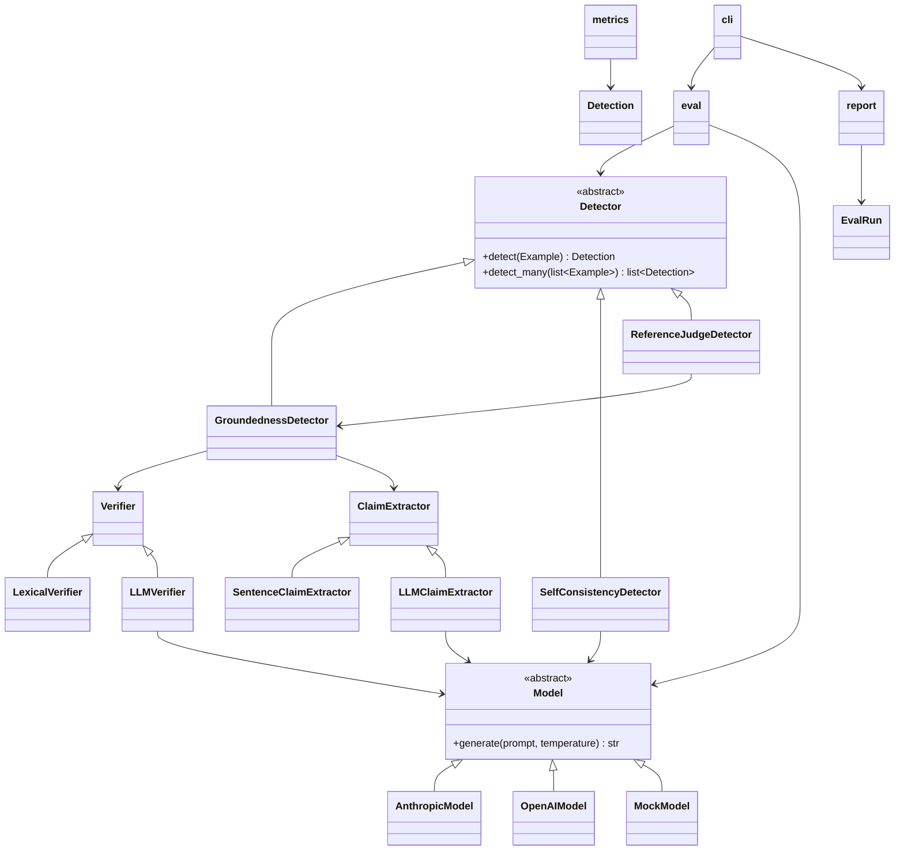

# Architecture

This document describes the module layout of `src/hh/`, the two extension
seams (`Detector` and `Model`), the data flow through the system, and step-by-step
guides for adding a new detector and a new model backend.

---

## 1. Module Map

```
src/hh/
├── __init__.py          Public API surface: detect(), load_dataset(), run_eval(), etc.
├── types.py             Core data types: Claim, Verdict, Detection, Example, EvalResult
├── claims.py            Claim extraction: SentenceClaimExtractor, LLMClaimExtractor
├── detectors/
│   ├── base.py          Detector ABC, registry (@register decorator, load_detector())
│   ├── groundedness.py  GroundednessDetector + LexicalVerifier + LLMVerifier
│   ├── self_consistency.py  SelfConsistencyDetector
│   └── reference_judge.py   ReferenceJudgeDetector (thin wrapper over groundedness)
├── models/
│   ├── base.py          Model ABC, registry (@register decorator, load_model())
│   ├── mock.py          MockModel — deterministic, offline, no API keys
│   ├── anthropic.py     AnthropicModel — Claude via the Anthropic API
│   └── openai.py        OpenAIModel — OpenAI-compatible API
├── dataset.py           load_dataset() / save_dataset() — JSONL I/O
├── eval.py              run_eval() — glue: dataset → detections → EvalResult
├── metrics.py           evaluate() — ConfusionMatrix, EvalResult, precision/recall/F1
├── report.py            to_markdown() / to_json() — human-readable output
└── cli.py               `hh` CLI — argparse, subcommands: eval / detect / list
```

### What each file is responsible for

| File | Responsibility |
|---|---|
| `types.py` | Immutable data contracts. No logic, no I/O. Every other module imports from here. |
| `claims.py` | Turning a raw answer string into a list of `Claim` objects. |
| `detectors/base.py` | The `Detector` abstract class and the name → class registry. |
| `detectors/groundedness.py` | The flagship detector plus the two verifiers. |
| `detectors/self_consistency.py` | Model-sampling-based detector; no source context needed. |
| `detectors/reference_judge.py` | Groundedness reused with the reference answer as the context. |
| `models/base.py` | The `Model` abstract class and the name → class registry. |
| `models/mock.py` | Deterministic offline backend; fixture or heuristic JSON verdicts. |
| `models/anthropic.py` | Claude backend; optional dep imported lazily. |
| `models/openai.py` | OpenAI-compatible backend; optional dep imported lazily. |
| `dataset.py` | JSONL loading/saving; maps raw dicts to `Example` objects. |
| `eval.py` | Orchestrates a full eval run: generate answers if needed, detect, aggregate. |
| `metrics.py` | `ConfusionMatrix` + `EvalResult` + `evaluate()` function. |
| `report.py` | `to_markdown()` and `to_json()` — consume an `EvalRun`, emit text. |
| `cli.py` | `hh eval`, `hh detect`, `hh list` subcommands. Calls the modules above. |

---

## 2. Module Relationship Diagram



---

## 3. Data Flow

```
                        JSONL file
                            │
                     load_dataset()
                            │
                    list[Example]
                            │
                  ┌─────────▼──────────┐
                  │    run_eval()       │
                  │  (eval.py)          │
                  │  optionally calls   │
                  │  Model.generate()   │
                  │  to fill in answers │
                  └─────────┬──────────┘
                            │ list[Example] with answers
                            │
                  ┌─────────▼──────────┐
                  │  Detector.detect() │
                  │  (for each example) │
                  └──┬──────────────┬──┘
                     │              │
              ClaimExtractor    Verifier
              .extract(answer)  .verify(claim, context)
                     │              │
                 list[Claim]    Verdict (per claim)
                     └──────────────┘
                            │
                       Detection
                    (verdicts + flag)
                            │
                  ┌─────────▼──────────┐
                  │   evaluate()       │
                  │   (metrics.py)     │
                  │   confusion matrix │
                  │   precision/recall │
                  └─────────┬──────────┘
                            │
                        EvalResult
                            │
                  ┌─────────▼──────────┐
                  │   to_markdown()    │
                  │   to_json()        │
                  │   (report.py)      │
                  └────────────────────┘
```

**Key invariant:** every piece of logic downstream of the detectors consumes
only `Detection` objects. That is what makes the system extensible — add a new
`Detector` and the metrics, report, and CLI work unchanged.

---

## 4. The Two Extension Seams

### 4.1 The `Detector` seam

`detectors/base.py` defines:

```python
class Detector(ABC):
    name: str = "detector"

    @abstractmethod
    def detect(self, example: Example) -> Detection: ...

    def detect_many(self, examples: list[Example]) -> list[Detection]:
        return [self.detect(ex) for ex in examples]
```

A class decorated with `@register("my_name")` is added to the detector registry
and becomes available as `--detector my_name` in the CLI and as
`hh.load_detector("my_name")` in the Python API.

### 4.2 The `Model` seam

`models/base.py` defines:

```python
class Model(ABC):
    name: str = "model"

    @abstractmethod
    def generate(self, prompt: str, *, system: str | None = None,
                 temperature: float = 0.0, max_tokens: int = 1024) -> str: ...
```

A class decorated with `@register("my_backend")` is added to the model registry
and becomes available as `--model my_backend` in the CLI and as
`hh.load_model("my_backend")` in the Python API.

Both registries follow the same pattern: a `_REGISTRY` dict maps string names to
classes, and `load_detector` / `load_model` instantiate by name, forwarding any
keyword arguments.

---

## 5. How to Add a New Detector

**Step 1.** Create `src/hh/detectors/my_detector.py`.

**Step 2.** Import and subclass `Detector`, register it:

```python
from ..types import Detection, Example
from .base import Detector, register

@register("my_detector")
class MyDetector(Detector):
    def __init__(self, threshold: float = 0.5, **_: object) -> None:
        self.threshold = threshold

    def detect(self, example: Example) -> Detection:
        # Produce a list of Verdict objects, one per claim.
        # Return a Detection wrapping example + verdicts.
        ...
```

The `**_` in `__init__` is a convention: `load_detector` forwards all CLI
keyword arguments, so absorbing unknown ones keeps the detector forward-compatible.

**Step 3.** Register the module as a builtin. In `detectors/base.py`, add your
import to `_register_builtins()`:

```python
def _register_builtins() -> None:
    from . import groundedness, self_consistency, reference_judge, my_detector  # noqa: F401
```

**Step 4.** Run `hh list` to confirm the detector appears, then add tests in
`tests/`.

**Step 5.** That is it. The CLI, `run_eval`, metrics, and `to_markdown` all
consume `Detection` objects and will work with your detector without any further
changes.

---

## 6. How to Add a New Model Backend

**Step 1.** Create `src/hh/models/my_backend.py`.

**Step 2.** Import and subclass `Model`, register it:

```python
import os
from .base import Model, register

@register("my_backend")
class MyBackendModel(Model):
    def __init__(self, model_id: str = "default-v1",
                 api_key: str | None = None, **_: object) -> None:
        self.model_id = model_id
        self._api_key = api_key or os.environ.get("MY_BACKEND_API_KEY")

    def generate(self, prompt: str, *, system: str | None = None,
                 temperature: float = 0.0, max_tokens: int = 1024) -> str:
        # Call your backend here and return a plain string.
        ...
```

Import the provider SDK lazily (inside `generate` or a helper method) so
the core package stays importable with no extra packages installed.

**Step 3.** Register the backend as a builtin. In `models/base.py`, add your
import to `_register_builtins()`:

```python
def _register_builtins() -> None:
    from . import mock, anthropic, openai, my_backend  # noqa: F401
```

**Step 4.** Add the provider package as an optional dependency in `pyproject.toml`
under `[project.optional-dependencies]`:

```toml
[project.optional-dependencies]
my_backend = ["my-backend-sdk>=1.0"]
```

**Step 5.** Run `hh list` to confirm the backend appears. Test offline with
`MockModel` first; add an integration test gated on an environment variable for
the real backend.
