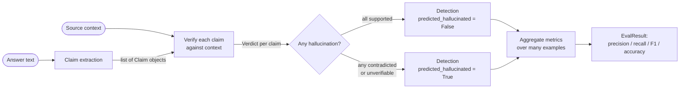

# Methodology: How Groundedness Detection Works

This document describes the full groundedness pipeline — from a raw answer string
to a `Detection` with per-claim verdicts and an overall hallucination flag — and
explains how detector quality is measured when gold labels are available.

---

## 1. The Core Idea

An answer is **grounded** if every factual claim it makes is supported by a source
you trust. Any claim the source does not support is treated as a hallucination,
whether the source actively contradicts it or simply contains no evidence for it.

The pipeline checks groundedness one claim at a time.

---

## 2. End-to-End Pipeline



**Step 1 — Claim extraction.** The answer is split into atomic factual statements,
each a single verifiable fact. Two extractors are available:

- `SentenceClaimExtractor` — deterministic sentence splitter using a small
  abbreviation guard. No model, no dependencies. The default.
- `LLMClaimExtractor` — asks a model backend to decompose the answer into atomic
  claims (one fact each) and returns a JSON array. Falls back to the sentence
  splitter if the model returns nothing parseable.

**Step 2 — Per-claim verification.** Each `Claim` is verified against the source
context by a `Verifier`. The verifier returns a `Verdict` containing:

- `support` — one of `supported`, `contradicted`, or `unverifiable`
- `score` — 0.0–1.0 confidence in that verdict
- `rationale` — human-readable explanation
- `evidence` — optional slice of context the verifier leaned on

**Step 3 — Aggregate.** A `Detection` collects all verdicts for one example. It
exposes `predicted_hallucinated` (True if any verdict is not `supported`) and
`groundedness` (fraction of claims that are supported).

---

## 3. The Three Verdicts

| Verdict | Meaning | Counts as hallucination? |
|---|---|:---:|
| `supported` | The context entails the claim. | no |
| `contradicted` | The context states the opposite of the claim. | **yes** |
| `unverifiable` | The context contains no evidence either way. | **yes** |

**Why do both `contradicted` and `unverifiable` count as hallucinations?**

The standard being enforced is *groundedness*: the answer must be traceable to
the provided source. A claim the source actively contradicts is an obvious
failure. A claim the source neither confirms nor denies is equally problematic
from a trustworthiness standpoint — the model asserted something with no
basis in the document. Both represent a breakdown in the answer's grounding.
Collapsing them into a single positive class keeps the evaluation clean: the
question is whether the context supports the claim, and the answer is binary.

---

## 4. The Two Verifiers

### 4.1 Lexical verifier (`verifier="lexical"`)

Computes content-word token overlap between the claim and the context after
stripping stop words.

- **Supported** if overlap ≥ 0.6 (configurable via `support_threshold`).
- **Contradicted** if overlap ≥ 0.6 but the claim and context have mismatched
  negation (one uses "not", "never", etc. and the other doesn't).
- **Unverifiable** otherwise (overlap too low or in the ambiguous middle range).

Tradeoffs:

| Dimension | Lexical |
|---|---|
| Speed | Very fast — O(n) string operations, no I/O |
| Dependencies | None — runs anywhere, including offline CI |
| Explainability | High — the token overlap ratio is directly inspectable |
| Paraphrase handling | Blind to it — "passed away" ≠ "died" lexically |
| Numeric precision | Weak — "200 km" and "300 km" share no content words |
| Negation detection | Heuristic — looks for negation tokens, not syntax |

The lexical verifier is the right starting point. It is deterministic, free to
run, and its failures are predictable: paraphrase, synonymy, and numeric
comparisons are where it breaks down.

### 4.2 LLM judge verifier (`verifier="llm"`)

Sends a structured prompt to a model backend asking it to classify the claim's
support level, then parses the JSON response `{"support": "...", "rationale": "..."}`.
Falls back to scanning for a verdict keyword if JSON parsing fails.

The prompt instructs the model to apply strict definitions of all three verdict
classes.

Tradeoffs:

| Dimension | LLM judge |
|---|---|
| Speed | Slow — one API call per claim |
| Dependencies | Requires a model backend (Anthropic, OpenAI, or the mock) |
| Explainability | Medium — the rationale field gives a reason, but it's model-generated |
| Paraphrase handling | Strong — a capable model understands semantics |
| Numeric precision | Better — a model can compare numbers in context |
| Error modes | The judge can itself hallucinate or misread the rubric |

The LLM judge is more accurate on semantic equivalences and complex reasoning,
but it is not infallible. A model judge that misreads the rubric or applies
inconsistent standards will produce noisy verdicts.

Choosing between them: start with `lexical` to get a cheap baseline. Switch to
`llm` when you need better recall on paraphrase-heavy answers, and verify that
the judge's outputs look sensible on a sample before trusting the aggregate
numbers.

---

## 5. Measuring Detection Quality

When the dataset includes gold labels (`gold_hallucinated: bool` per example),
the pipeline scores the detector against those labels. The positive class is
**hallucinated** (the interesting thing to catch).

### 5.1 Confusion matrix

```
                  gold: hallucinated    gold: clean
pred: hallucinated       TP                  FP
pred: clean              FN                  TN
```

- **TP** — correctly caught hallucination
- **FP** — false alarm on a clean answer
- **FN** — missed a hallucination (the most dangerous failure)
- **TN** — correctly passed a clean answer

### 5.2 Metrics

```
Precision  = TP / (TP + FP)   — of flagged answers, what fraction were truly hallucinated?
Recall     = TP / (TP + FN)   — of truly hallucinated answers, what fraction did we catch?
F1         = 2 * P * R / (P + R)
Accuracy   = (TP + TN) / total
```

Which metric to prioritise depends on the use case. If the cost of a missed
hallucination is high (medical, legal), optimise recall. If the cost of false
alarms is high (user experience, downstream filtering), optimise precision.

### 5.3 Hallucination rate vs detection quality

These two numbers measure different things:

- **Hallucination rate** — what fraction of answers the detector flags. This
  describes the *data* (or the model generating the answers), not the detector.
- **Detection quality** (precision / recall / F1) — how well the detector's flags
  match human judgement. This describes the *detector*.

Both are reported in the `EvalResult`; both appear in the Markdown report.
